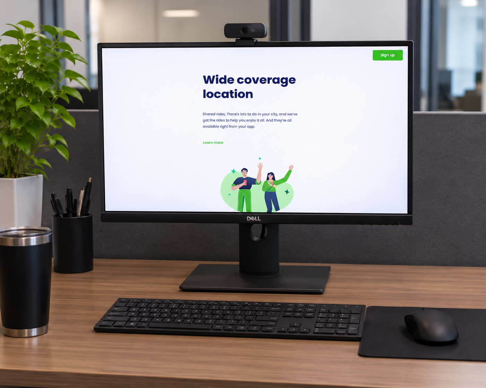

<h1 align="center"> Wide coverage location </h1> 
 
 
<h2 align="center"> Esse foi um projeto que aprendi no <a href= "https://www.devclub.com.br/">DEVCLUB</a> durante os módulos de HTML e CSS </h2>
 

 
<h2> Linguagens utilizadas</h2>
 
 

